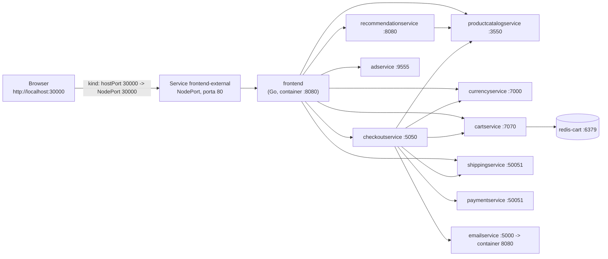

# Architettura essenziale

> Applicazione: **Online Boutique** (Google Cloud) – repository originale: <https://github.com/GoogleCloudPlatform/microservices-demo>
> Versione usata: **v0.10.7**. Manifest copiato inalterato in `k8s/base/boutique.yaml`.

## 1. Flussi principali

Il diagramma riporta le dipendenze lette dalle variabili `*_ADDR` dei manifest e corrisponde esattamente allo stato di networking interno al cluster distribuito tramite il namespace `challenge-l2`.

Note verificate sui manifest:
- `kind-config.yaml` mappa la porta 30000 dell'host sulla porta 30000 del nodo kind.
- Il frontend referenzia anche `shoppingassistantservice`, ma è una funzione opzionale non presente nel manifest di base: non è deployata.
- Il `loadgenerator` è rimosso dall'overlay `local` (motivazione nel README).

## 2. Componenti e Protocolli

| Componente | Ruolo | Porta del Service | Tipo di Probe |
|---|---|---|---|
| `frontend` | Interfaccia web; chiama tutti i servizi gRPC | 80 → container 8080 | HTTP `/_healthz` |
| `productcatalogservice` | Catalogo prodotti | 3550 | gRPC |
| `currencyservice` | Conversione valute | 7000 | gRPC |
| `cartservice` | Gestione carrello (salva su `redis-cart`) | 7070 | gRPC |
| `redis-cart` | Datastore del carrello (volume `emptyDir`) | 6379 | TCP |
| `recommendationservice` | Prodotti consigliati (usa il catalogo) | 8080 | gRPC |
| `shippingservice` | Calcolo costo di spedizione | 50051 | gRPC |
| `checkoutservice` | Orchestra l'ordine (catalogo, carrello, pagamento, email) | 5050 | gRPC |
| `paymentservice` | Pagamento simulato | 50051 | gRPC |
| `emailservice` | Email di conferma simulata | 5000 → container 8080 | gRPC |
| `adservice` | Annunci contestuali | 9555 | gRPC |

## 3. Risorse Kubernetes create

- **Namespace:** `challenge-l2` (dichiarato in `k8s/overlays/local/namespace.yaml`).
- **Workloads:** 11 Deployment (10 microservizi + `redis-cart`) e 10 ServiceAccount (`redis-cart` non ne ha uno dedicato).
- **Service:** 12 in totale: 11 di tipo `ClusterIP` per la comunicazione interna tra servizi e 1 di tipo `NodePort` (`frontend-external`, porta 30000) per l'accesso dal browser host.
- **ConfigMap:** 1 ConfigMap generato dinamicamente (`frontend-config`, con suffisso hash per innescare i rollout) che fornisce `FRONTEND_MESSAGE` al frontend.
- **Secret:** Nessuno. L'applicazione non richiede credenziali, evitandone l'esposizione in chiaro.
- **Probe Native:** Controlli di stato ereditati intatti da upstream. *Nota tecnica:* Le probe vengono eseguite dal demone `kubelet` direttamente sull'IP del Pod, non passando dal Service. Questo è il motivo per cui nell'incidente di rete (Service rotto), i pod risultavano comunque `Ready`.
- **Sicurezza:** Verificata sul Deployment del frontend: `runAsNonRoot: true`, `runAsUser: 1000`, `readOnlyRootFilesystem: true`, `allowPrivilegeEscalation: false`, `capabilities: drop: [ALL]`.

## 4. L'approccio dichiarativo con Kustomize

Il file `k8s/base/boutique.yaml` funge da *Single Source of Truth* immutabile. Quando si esegue `kubectl apply -k`, Kustomize genera i manifest finali unendo base e patch dell'overlay; poi `kubectl apply` li confronta con lo stato del cluster e applica le differenze. 
*Nota architetturale:* Questa configurazione rende le modifiche ripetibili e versionate. Tuttavia, non è "GitOps" in senso stretto, poiché manca un agente a ciclo continuo (come Argo CD o Flux) che riconcili il cluster in automatico; il push dei manifest è demandato all'operatore tramite comando `make`.

| Overlay | Scopo e Modifiche applicate alla Base |
|---|---|
| `local` | Namespace target, NodePort 30000, rimozione del loadgenerator, ConfigMap `frontend-config` (banner vuoto). |
| `demo-reconfig` | Inietta il banner testuale nel ConfigMap (l'hash cambia → nuovo rollout automatico del frontend). |
| `incident-1` | Patch: altera il tag immagine del frontend in `tag-inesistente` (`ImagePullBackOff`). |
| `incident-2` | Patch: disallinea il selector del Service `productcatalogservice` (EndpointSlice `<unset>`). |

## 5. Il Dockerfile del frontend

Non sono stati scritti Dockerfile custom; le immagini sono quelle upstream. Analizzando il Dockerfile originale del frontend (`src/frontend/Dockerfile`) si notano standard di sicurezza e ottimizzazione eccellenti:

- **Build multi-stage:** Uno stage usa l'immagine Go per compilare il binario; lo stage finale copia solo il binario e i file statici. Gli strumenti di build (potenziali vettori di attacco) non finiscono nell'immagine di produzione.
- **Cache dei layer:** Le dipendenze Go si scaricano (`go mod download`) prima di copiare il codice sorgente, così Docker riusa la cache finché i file `.mod` e `.sum` non cambiano.
- **Binario statico:** La compilazione con `CGO_ENABLED=0` produce un eseguibile senza dipendenze dalla libreria C di sistema.
- **Immagine finale distroless:** `gcr.io/distroless/static` non contiene shell (`/bin/sh`), `curl` né package manager. Questo minimizza drasticamente la superficie di attacco in caso di esecuzione remota di codice (RCE).
- **Utente non root:** Il Dockerfile non imposta forzatamente la direttiva `USER`. L'esecuzione come utente non privilegiato è imposta in modo stringente a livello orchestratore dal `securityContext` del manifest Kubernetes.