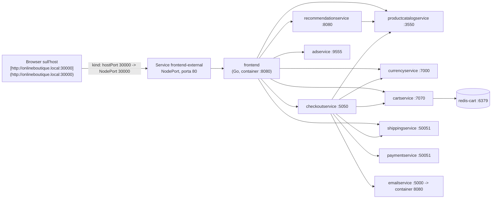

# Architettura essenziale

> Applicazione: **Online Boutique** (Google Cloud) – repository originale: <https://github.com/GoogleCloudPlatform/microservices-demo>
> Versione usata: **v0.10.7**. Manifest copiato inalterato in `k8s/base/boutique.yaml`.

## 1. Flussi principali

Il diagramma corrisponde esattamente allo stato di networking interno al cluster distribuito tramite il namespace `challenge-l2`.

## 2. Risorse Kubernetes create

- **Namespace:** `challenge-l2` 
- **Workloads:** 11 Deployment microservizi + 11 ServiceAccount segregati.
- **Networking:** 11 Service di tipo `ClusterIP` (per la comunicazione sicura inter-pod gRPC) e 1 Service `NodePort` (`frontend-external`) modificato tramite patch per l'esposizione locale.
- **Probe Native:** Controlli di stato HTTP e gRPC ereditati intatti dal progetto upstream per evitare falsi positivi nel monitoring L2.

## 3. L'approccio GitOps e Kustomize

Piuttosto che modificare brutalmente i file YAML originali (anti-pattern), il progetto adotta `Kustomize`. Il file `k8s/base/boutique.yaml` funge da *Single Source of Truth* immutabile. Le personalizzazioni (come il port forwarding, la rimozione del loadgenerator o l'iniezione degli incidenti simulati) avvengono tramite *Overlay*.
Quando si esegue `kubectl apply -k`, Kustomize computa il diff a runtime, applicando in modo sicuro e reversibile i layer necessari.

## 4. Il Dockerfile del frontend 

Analizzando il codice di partenza di Online Boutique (`src/frontend/Dockerfile`), si notano standard di sicurezza eccellenti:
- **Build Multi-Stage:** Utilizza `golang:alpine` per compilare il binario, abbandonando gli strumenti di compilazione nello step successivo.
- **Distroless:** L'immagine di produzione usa `gcr.io/distroless/static`. Non possiede shell (`/bin/sh` o `bash`), curl, o package manager. Questo minimizza drasticamente la superficie di attacco: in caso di esecuzione remota di codice (RCE), l'aggressore non avrà strumenti di sistema da utilizzare per la privilege escalation.